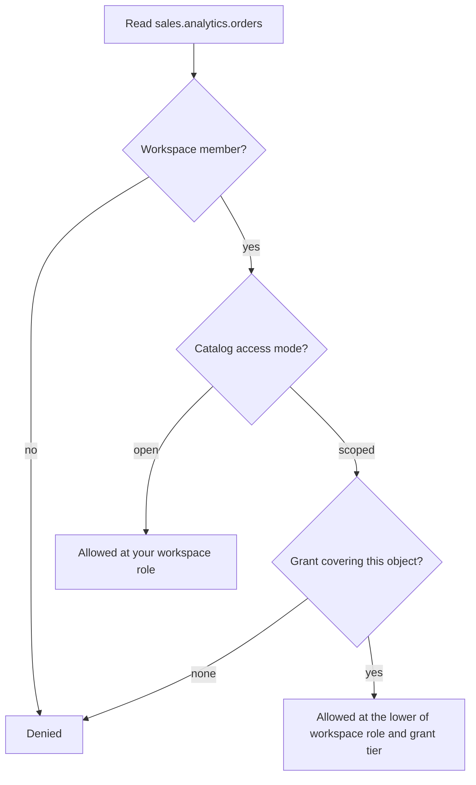

# How access works

DuckHaven decides what you can do in four independent layers, and a request is allowed only if it clears every layer
that applies to it.

| Layer | The question it answers | Values | Scope |
|---|---|---|---|
| **1 · Global role** | What can you *administer*? | `admin`, `user` | The whole deployment |
| **2 · Workspace role** | Which workspaces can you enter, and what can you do inside them? | `reader`, `writer`, `owner` | One workspace |
| **3 · Data grants** *(opt-in)* | Inside a *scoped* catalog, which exact objects can you see and read? | `metadata`, `reader`, `writer` — on a catalog, schema or table | One principal × one object |
| **4 · Agent access** *(opt-in)* | Which compute may you run on, and what may you do to it? | `use`, `operate`, `admin` | One principal × one agent |

The exact permissions behind each value are in the [permissions reference](../reference/permissions.md). The same four
layers apply to people and to [service accounts](service-accounts.md), including the one the
[AI assistant](../ai/assistant.md) acts as.

!!! note "The layers are independent"
    A global `admin` cannot read your data without workspace membership, and a workspace `owner` is not an admin.
    Touching data always needs workspace membership (layer 2); administering the platform always needs a global role
    (layer 1).

Layers 1–3 govern **data**: which objects a request may touch. Layer 4 governs **compute**: which agent may run it.
Being allowed to read a table says nothing about which agent you may run the query on, and the reverse.

## Signing in

An account signs in one of three ways:

- **Local** — email and password. Always available, so an admin can sign in even when the identity provider is down.
- **Single sign-on** — your organization's OpenID Connect provider, such as Microsoft Entra ID, Okta or Keycloak. See
  [Connect an IdP](connect-idp.md).
- **LDAP or Active Directory** — a directory bind. See [Connect LDAP / AD](connect-ldap.md).

When you submit a password, DuckHaven checks it against a local account first and tries LDAP only if there is no local
password for that email. The first time someone signs in through single sign-on or LDAP, DuckHaven creates their
account; on every sign-in it refreshes their name and global role from the directory. An email already registered to a
different sign-in method is refused, so a directory account cannot take over a local admin.

Every sign-in produces the same kind of session: an opaque token stored on the server, so signing out, expiry and
[revoking sessions](offboarding.md) behave the same whichever way you signed in.

## Layer 1 — Global role: what you can administer

Every account has one global role, `admin` or `user`. It is about operating DuckHaven — agents, storage backends,
users, maintenance — not about reading data: a new admin sees no tables until they join a workspace. `admin` holds every
[global permission](../reference/permissions.md#global-permissions); `user` holds none. For people who sign in through
an identity provider, the role follows their group membership, for example `dh-admins → admin`, so promoting or
demoting someone is a change in the directory.

## Layer 2 — Workspace role: your access to a workspace's data

A [workspace](workspaces.md) groups the catalogs a team works with. To touch any data you must be a member, with one
role: `reader` browses and queries, `writer` also changes tables, and `owner` also manages members, catalogs and
grants. The [permissions reference](../reference/permissions.md#workspace-roles) lists exactly what each role allows.

By default your role applies to **every** schema and table in **every** catalog the workspace attaches. Most teams
configure nothing beyond layers 1 and 2: add people to a workspace, pick a role. See
[Manage users & access](manage-users.md).

## Layer 3 — Data grants: narrower access to a catalog

When a workspace role is too coarse — "this analyst should see `marketing` but not `finance`", or "this coding agent
may discover a table but never read its rows" — make the catalog's attachment **`scoped`** instead of `open`. In a
scoped catalog a member sees only what a grant gives them, at the lower of the grant's tier and their workspace role.

Scoping changes more than who sees which tables: it also turns off engine-side listing such as `information_schema` for
the whole workspace. Read [Scoped access](scoped-access.md) before switching a catalog.

## Layer 4 — Agent access: which compute you may run on

By default every [agent](../compute/agents.md) is `open`: anyone signed in can run work on it. A **`restricted`** agent
needs a grant, given to a person or to a whole workspace, and is invisible to everyone without one. Tiers above `use`
let someone restart or administer an agent. See [Agent access](agent-access.md).

## How the layers combine

To decide whether someone may read a table, DuckHaven walks layers 1–3 in order:

1. **Not a member of the workspace?** Denied — a global admin is no exception.
2. **Member, and the catalog is `open`?** Allowed at your workspace role.
3. **Member, and the catalog is `scoped`?** Allowed at the lower of your workspace role and the best grant covering that
   object. With no covering grant, denied.

The same walk runs for **every** object a request touches: a query that joins two tables must clear it for both, and
the catalog tree shows only what you can at least discover.

Layer 4 is checked alongside: a query names an agent as well as tables, and must clear both. Holding `use` on an agent
does not let you read anything you could not read anyway.

## A worked example

Dana is a data analyst:

- **Layer 1** — global role `user`.
- **Layer 2** — in workspace `dev` she is a `writer`.
- **Layer 3** — `dev` attaches two catalogs. `marketing` is **open**; `sales` is **scoped**, and Dana has a `reader`
  grant on `sales.analytics.orders`.

| Action | Allowed? | Which layer decided it |
|---|---|---|
| Open **Admin → Users** | No | Layer 1 — she is a `user`, not an `admin` |
| Query any table in `marketing` | Yes, as a writer | Layer 2 — `marketing` is open, so her `writer` role applies |
| Query `sales.analytics.orders` | Yes, read-only | Layer 3 — her `reader` grant |
| `INSERT` into `sales.analytics.orders` | No | Layer 3 — the `reader` grant caps her below her `writer` role |
| See `sales.finance.*` at all | No — it is not listed | Layer 3 — no grant, so the tree hides it |

## Which layer do I change?

| You want to… | Change | Where |
|---|---|---|
| Let someone manage agents, storage or users | Layer 1 (global role) | **Admin** → **Users** |
| Give someone access to a workspace's data | Layer 2 (workspace role) | **Admin** → **Users** → **Manage workspaces**, or a workspace owner adds them |
| Restrict access to specific schemas or tables | Layer 3 (data grants) | Catalog tree → right-click → **Permissions**, on a `scoped` catalog |
| Reserve an agent for one team, or let someone restart it | Layer 4 (agent access) | **Compute** → the agent → **Access** |

## What is not supported

- **Row- or column-level security.** The finest grant is a table; there are no row filters or column masks.
- **Group-based data grants.** A data grant names a person or service account. Only agent access can name a workspace.
- **SCIM provisioning.** Accounts are created when people first sign in, not pushed from the directory.
- **Joins across workspaces.**

DuckHaven is the only place permissions are enforced. Polaris sees a single service principal, never individual users.

## Related

- [Permissions reference](../reference/permissions.md) — every permission, role and tier.
- [Scoped access](scoped-access.md) — data grants in depth.
- [Agent access](agent-access.md) — reserving compute.
- [Manage users & access](manage-users.md) — the how-to for layers 1 and 2.
