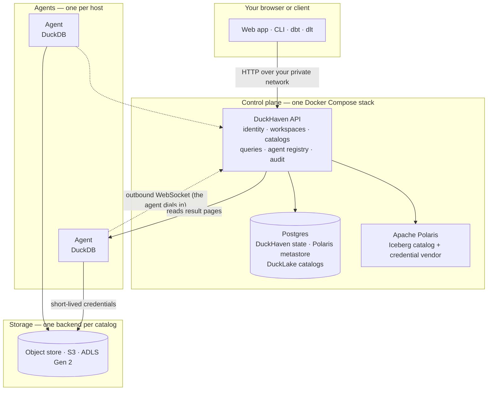

# How DuckHaven works

DuckHaven splits into a control plane that decides what may run and agents that run it, with your tables on object
storage you own.

The **control plane** is one Docker Compose stack: the DuckHaven API and web app, Postgres, and Apache Polaris. It
knows who you are, which workspaces and catalogs you can reach, and which agent should run your query. It never runs
your SQL itself.

**Agents** are DuckDB processes that run queries. The stack ships one; you can add more on other hosts, or let
DuckHaven start them on demand with [elastic compute](../compute/elastic-compute.md). You choose the agent for each
query.

**Tables** live in [catalogs](../data/catalogs.md) on a [storage backend](../data/storage-backends.md): the bundled
object store, Amazon S3, or Azure Data Lake Storage Gen 2.

## What runs where

| Piece | What it does | Where it runs |
|---|---|---|
| API and web app | Serves the web app and the REST API on port 8000, checks every request, sends queries to agents, keeps history | The control-plane stack |
| Postgres | Stores users, workspaces, saved queries and history, the Polaris metastore, and DuckLake catalog metadata | The control-plane stack |
| Apache Polaris | Owns the structure of Iceberg catalogs and hands agents short-lived storage credentials | The control-plane stack |
| Bundled object store | S3-compatible storage for catalogs that do not use your own bucket | The control-plane stack |
| Agent | Embeds DuckDB, runs queries, keeps their results for 24 hours | Any host that can reach the API |
| Tracing (OpenTelemetry Collector, Tempo, Grafana) | Records request traces; see [Distributed tracing](../operations/tracing.md) | The control-plane stack |

Everything the control plane knows is in Postgres, so [backing up](../deployment/backup-restore.md) Postgres and the
API's secret key backs up DuckHaven. Table data lives on the storage backends and is backed up with their own tools.

## What happens when you run a query

1. **The API checks the query.** It confirms you can use the workspace and the agent, that the statement is one
   DuckHaven runs (see [SQL support](../reference/sql-support.md)), and, in a scoped catalog, that you hold a grant on
   every table the query names. Nothing runs until all of these pass.
2. **The API sends it to the agent you chose.** If that agent is not connected, the query fails at once with *Agent
   not connected* rather than waiting. A stopped [elastic](../compute/elastic-compute.md) agent is started first.
3. **The agent sizes it and runs it.** It estimates the memory the query needs from DuckDB's plan and reserves it; when
   the agent is busy, the query waits for room rather than running out of memory. See
   [Query execution](../querying/query-execution.md).
4. **The result stays on the agent.** The agent writes the result as Parquet and keeps it for 24 hours. The web app
   pages through it on demand, so a large result is never loaded whole. After 24 hours the result expires and you run
   the query again.

Cancelling a query, or hitting its timeout, stops it on the agent. Every run is recorded in the workspace's
[history](../querying/run-queries.md#find-an-earlier-run), whether it succeeded or not.

## How agents connect

An agent opens the connection, not the control plane: it dials the API's `/agents/connect` WebSocket and keeps it
open. So an agent can sit behind NAT or a firewall that allows outbound traffic, and adding one needs no change on the
control plane. The API connects back to an agent only to read result pages, over HTTP.

An agent registers once with a single-use bootstrap token, which it exchanges for its own long-lived credential. See
[Add an agent](../compute/add-agent.md).

Agents never store long-lived storage keys. When a query opens a catalog, the agent receives short-lived credentials
scoped to that catalog: from Polaris for an Iceberg catalog, from the API for a DuckLake one.

## Design choices that shape what you see

- **You pick the engine.** DuckHaven dispatches; it does not plan queries across agents or route them by cost. A query
  runs on exactly one agent, and adding agents adds capacity for more queries, not for one bigger query.
- **Storage belongs to the catalog.** Each catalog has one storage backend, chosen when you create it and changed only
  by a [storage migration](../data/catalogs.md#storage-migration). A workspace reaches storage through the catalogs it
  attaches.
- **The API is the gate.** Every permission check happens in the API before a query reaches an agent, including
  [scoped grants](../access/scoped-access.md) down to a table.

## Boundaries

DuckHaven deliberately is **not**:

- **A distributed warehouse.** Agents are independent DuckDB processes; a query never spans two of them, and there is
  no cross-agent transaction.
- **A multi-engine platform.** DuckDB is the only engine.
- **A notebook platform.** You work in SQL worksheets, or connect your own tools.
- **Internet-facing.** It is built to sit on a private network such as Tailscale; put a
  [reverse proxy with TLS](../deployment/reverse-proxy-tls.md) in front if you expose it more widely.
- **An extraction tool.** It has no source connectors. Data arrives through SQL, through dlt or dbt over a
  [SQL session](../querying/sql-sessions.md), or from engines such as Spark and PyIceberg writing to the storage
  backends directly.
- **Row- or column-level security.** The finest access grant is a table, and joins across workspaces are not supported.

## Glossary

| Term | Meaning |
|---|---|
| **Control plane** | The DuckHaven API with Postgres and Polaris. Decides what runs where; never runs your SQL. |
| **Agent** | A process embedding DuckDB, running on its own host and connected to the API over a WebSocket. The unit of compute. |
| **Workspace** | Where a team works: its members, roles, history, and the catalogs it attaches. |
| **Catalog** | A data domain with one catalog kind and one storage backend, attachable to many workspaces. |
| **Catalog kind** | Where a catalog's metadata lives and what format its tables use: Iceberg in Polaris, or DuckLake in Postgres. |
| **Storage backend** | A registered storage location — the bundled object store, an S3 bucket, or ADLS Gen 2 — that catalogs use. |
| **Bootstrap token** | A single-use token that lets a new agent register. |
| **Capabilities** | What an agent reports about itself — DuckDB version, extensions, memory — which DuckHaven checks to decide which catalogs it can serve. |
| **SQL session** | A persistent connection on one agent, brokered by the API, so tools such as dbt and dlt can run many statements with shared state. |
| **Vended credentials** | Short-lived storage credentials for one catalog, given to an agent for one connection. |

## Related

- [What is DuckHaven?](what-is-duckhaven.md) — why it exists and who it is for.
- [Query execution](../querying/query-execution.md) — admission, memory and results in detail.
- [Agents](../compute/agents.md) — choosing, adding and restricting compute.
- [Architecture for contributors](../developer/architecture.md) — the same system in terms of the code.
